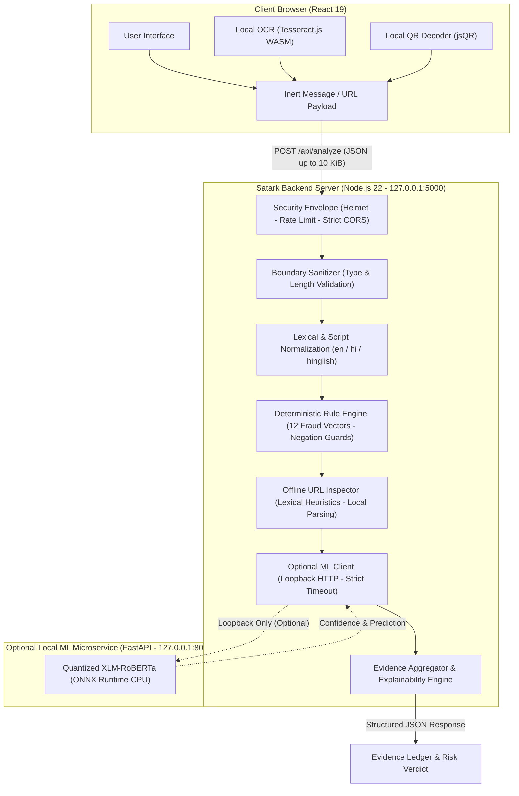
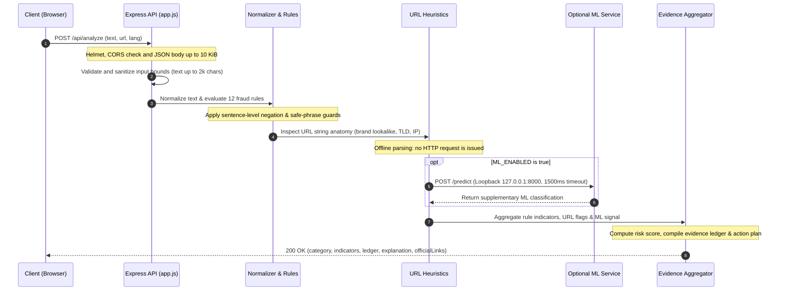

<div align="center">

# Satark • सतर्क

**Explainable Multilingual Scam & Fraud Message Detection Engine**

A deterministic screening engine for SMS, WhatsApp, and UPI fraud vectors across English, Hindi, and Hinglish. Message content is held in memory during analysis and is not written to logs or storage by design.

[](LICENSE)
[](https://nodejs.org/)
[](https://www.python.org/)
[](https://react.dev/)
[](server/tests)
[](#privacy-and-security-guarantees)

<p align="center">
  <a href="#why-satark">Why Satark?</a> •
  <a href="#why-satark-vs-a-generic-llm">Satark vs LLM</a> •
  <a href="#problem-and-solution-in-action">Problem and Solution</a> •
  <a href="#system-architecture">Architecture</a> •
  <a href="#threat-categories-and-severity-weights">Threat Rules</a> •
  <a href="#evaluation-discipline-and-benchmarks">Benchmarks</a> •
  <a href="#getting-started">Getting Started</a> •
  <a href="#api-reference">API</a> •
  <a href="#known-limitations">Limitations</a>
</p>

</div>

---

## Table of Contents

- [Why Satark](#why-satark)
- [Why Satark vs a Generic LLM](#why-satark-vs-a-generic-llm)
- [Problem and Solution in Action](#problem-and-solution-in-action)
- [System Architecture](#system-architecture)
- [Threat Categories and Severity Weights](#threat-categories-and-severity-weights)
- [Privacy and Security](#privacy-and-security-guarantees)
- [Evaluation Discipline and Benchmarks](#evaluation-discipline-and-benchmarks)
- [Known Limitations](#known-limitations)
- [Tech Stack and Repository Map](#tech-stack-and-repository-map)
- [Getting Started](#getting-started)
- [API Reference](#api-reference)
- [Testing and Verification](#testing-and-verification)
- [Official Civic Reporting Channels](#official-civic-reporting-channels)
- [License and Author](#license-and-author)

---

## Why Satark

In the Indian telecommunications ecosystem, financial fraud targets users across mixed languages, scripts, and colloquial phrasing. Common attack vectors include:

- **Electricity Disconnection Threats (*Bijli Cutoff*)**: Fabricated overdue utility bills threatening power shutoffs tonight.
- **Digital Arrests & Agency Impersonation**: False police, customs, ED, or TRAI notices threatening arrest warrants for alleged courier parcels or SIM misuse.
- **Predatory Loan & Processing Fees**: Pre-approved loans demanding advance clearance fees, stamp duty, or insurance via UPI.
- **UPI Collect & Cashback Lures**: Tricking sellers or wallet users into approving UPI collect prompts with their secret MPIN.
- **SIM Swap & 5G Upgrade Traps**: Soliciting 20-digit SIM numbers, Aadhaar digits, or date of birth under the guise of carrier upgrades.
- **Banking Lookalikes & KYC Panics**: Fake netbanking portals hosted on `.xyz`, `.top`, `.click`, or `.biz` mimicking SBI, HDFC, ICICI, or PNB.

Satark provides transparent, deterministic screening with an interactive evidence ledger detailing exactly which words, domains, or urgency patterns triggered the classification.

---

## Why Satark vs a Generic LLM

Cloud-hosted LLM APIs introduce privacy, latency, and operational considerations for personal telecommunications fraud analysis:

| Evaluation Dimension | Satark Scam Detection Engine | Cloud-hosted LLM APIs |
| :--- | :--- | :--- |
| **User Privacy & Egress** | **Local processing by design**: The rule engine runs in memory, server integrations use loopback addresses, and browser media parsing runs locally. | Message content is sent to a third-party service over the Internet for analysis. |
| **Inference Latency** | Local JavaScript rule evaluation avoids a network round trip. | Latency depends on network conditions, service load, and generation length. |
| **Explainability** | **Deterministic Evidence Ledger**: Exact character substring offsets, rule identifiers, and explicit threat weights. | **Opaque Post-Hoc Text**: Generated justifications may not expose which tokens governed the decision. |
| **Operational Cost** | The rule engine has no API token cost and runs on CPU-based local systems. | Pricing depends on provider and usage. |
| **Advisory False Positives** | The repository includes benchmark results and tests for sentence-level negation guards. | Comparative results against cloud-hosted LLM APIs are outside this evaluation. |

---

## Problem and Solution in Action

Below is an end-to-end example demonstrating how Satark analyzes a realistic Hinglish banking scam message:

| Incoming Threat Message | Satark Explainable Analysis & Verdict |
| :--- | :--- |
| **Message Text:**<br>`"SBI account band ho jayega. Turant KYC update karein aur apna OTP bhejein within 2 hours: http://sbi-kyc-update.xyz"`<br><br>**Context:**<br>Hinglish banking lure combining an account-blocking threat, KYC pressure, OTP solicitation, and a lookalike link. | **Risk Tier:** `Suspicious` (Score: 12)<br><br>**Indicators:**<br>- `FEAR` (Weight: 2) -> Matched `"account band ho jayega"`<br>- `URGENCY` (Weight: 1) -> Matched `"Turant"`<br>- `KYC_LURE` (Weight: 2) -> Matched `"KYC update"`<br>- `OTP_REQUEST` (Weight: 3) -> Matched `"apna OTP bhejein"`<br>- `URGENCY` (Weight: 1) -> Matched `"within 2 hours"`<br><br>**URL Evidence:**<br>- URL status `checked`; flags `no_https`, `suspicious_tld`, `many_hyphens`, `brand_lookalike`<br><br>**Suggested Action Plan:**<br>1. Do not share an OTP, PIN or CVV with anyone.<br>2. Do not click the link. Open your bank's official app/website yourself.<br>3. Report suspected fraud by calling `1930` or using `cybercrime.gov.in`. |

---

## System Architecture

Satark executes through a multi-tier pipeline that keeps heuristic evaluation in process and supports optional loopback machine learning augmentation.



<details>
<summary>View ASCII Architecture Diagram</summary>

```text
┌─────────────────────────────────────────────────────────────────────────────┐
│                            Client Browser (React 19)                        │
│                                                                             │
│  [ Text Input ]       [ Screenshot OCR (WASM) ]       [ QR Scanner (jsQR) ] │
│         │                         │                             │           │
│         └─────────────────────────┼─────────────────────────────┘           │
│                                   │                                         │
│                      Inert Client Payload Route                             │
└───────────────────────────────────┬─────────────────────────────────────────┘
                                    │ POST /api/analyze (JSON <= 10 KiB)
                                    ▼
┌─────────────────────────────────────────────────────────────────────────────┐
│                         Satark API Server (Node / Express 5)                │
│                                                                             │
│  ├── Security Envelope (Helmet, CORS Allowlist, Rate Limiting 30 req/min)   │
│  ├── Boundary Sanitizer (Length truncation, Type validation)                │
│  │                                                                          │
│  ├── [1] Lexical & Script Normalization (en / hi / hinglish)                │
│  │                                                                          │
│  ├── [2] Deterministic Rule Engine                                          │
│  │     ├── 12 Core Fraud Vectors (bounded regular expressions)              │
│  │     └── Sentence-Level Negation & Contextual Advisory Guards             │
│  │                                                                          │
│  ├── [3] Offline URL Inspection (Lexical heuristics, local parsing)          │
│  │                                                                          │
│  ├── [4] Optional Asynchronous ML Classifier (Loopback 127.0.0.1:8000)      │
│  │     └── XLM-RoBERTa ONNX Runtime (CPU bound, strict timeout & fallback)  │
│  │                                                                          │
│  └── [5] Evidence Aggregator & Explainability Formatter                     │
└───────────────────────────────────┬─────────────────────────────────────────┘
                                    │
                                    ▼
┌─────────────────────────────────────────────────────────────────────────────┐
│                          Structured Result Schema                           │
│                                                                             │
│  • Category: Suspicious | Caution | No known red flags found                │
│  • Risk Score & Highlighted Substring Spans                                 │
│  • Evidence Ledger & Threat Explanation (en, hi, hinglish)                  │
│  • Prescribed Action Plan & Official Reporting Links                        │
└─────────────────────────────────────────────────────────────────────────────┘
```

</details>

### Request Lifecycle Sequence



---

## Threat Categories and Severity Weights

Satark groups fraud patterns by configured severity weight into a unified scoring index. Weight 3 covers direct credential and payment compromise, weight 2 covers deceptive or unsolicited lures, and weight 1 covers pressure signals. Scores 4 or higher trigger `Suspicious`, scores 1-3 trigger `Caution`, and score 0 produces `No known red flags found`. Risky URL evidence contributes 3 points for one independent cause or 4 points for two or more independent causes per URL, capped at 6 total; a missing HTTPS flag alone does not add URL score.

| Severity Group | Weight | Rule ID | Description & Signal Focus |
| :--- | :---: | :--- | :--- |
| **High Severity (Direct Compromise)** | **3** | `OTP_REQUEST` | Solicitation of one-time passwords, UPI MPINs, card CVVs, or login verification codes. |
| | **3** | `SENSITIVE_INFO_REQUEST` | Demands for 20-digit SIM ICCIDs, Aadhaar numbers, PAN numbers, or netbanking passwords. |
| | **3** | `JOB_FEE` | Demands for registration deposits or training fees for task-based or "Work from Home" offers. |
| | **3** | `UPI_COLLECT` | Fraudulent collect prompts instructing victims to approve transactions or enter PIN to "receive" funds. |
| | **3** | `ADVANCE_FEE` | Demands for customs release fees or parcel handling charges on unexpected foreign parcels. |
| **Medium Severity (Deceptive and Unsolicited Lures)** | **2** | `KYC_LURE` | Threats of service cancellation or KYC expiration. |
| | **2** | `FEAR` | Threats of immediate power disconnection, police inquiry, account termination, or FIR filings. |
| | **2** | `FAKE_REWARD` | Unsolicited lottery winnings, cashback scratch cards, or free mobile phone announcements. |
| | **2** | `IMPERSONATION` | Spoofing trusted organizations (SBI, HDFC, TRAI, Police, Customs, Electricity Boards, India Post). |
| | **2** | `LOAN_FEE` | Demands for pre-disbursal processing fees, stamp duty charges, or collateral-free clearance fees. |
| | **2** | `UNSOLICITED_REFUND` | Unsolicited refund, subsidy, or mistaken credit lures requiring user action. |
| **Low Severity (Pressure Signals)** | **1** | `URGENCY` | Artificial deadlines (*"within 2 hours"*, *"aaj raat 10 baje se pehle"*). |

### Smart Negation and Safe Phrase Guards

Legitimate bank alerts frequently contain warning keywords. Satark uses sentence-level negation filters to prevent false positives:
- **Banking Advisory Negation**: Phrases like *"Never share your OTP with anyone"* neutralize `OTP_REQUEST` flags.
- **Transactional Confirmation**: Completed debit alerts (*"INR 2,500 debited from A/c... Avail balance INR 45,000"*) are recognized as legitimate history.
- **Physical Branch Direction**: Messages directing users to visit their official local bank branch are suppressed from phishing classifications.

---

<a id="privacy-and-security-guarantees"></a>

## Privacy and Security

> [!TIP]
> ### Local Processing by Design
> Message content is held in memory during analysis. Inspected Node and Python service paths do not write raw message text to logs or storage.

- **Message Handling**: The analyzer processes submitted text in memory, and the analyzer path does not log raw message content.
- **Loopback ML Integration**: The local ML client targets numeric loopback and treats redirects as errors.
- **Offline URL Heuristics**: URL inspection parses submitted strings locally and does not issue HTTP requests.
- **Hardened HTTP Defaults**: Express 5 enforces `helmet()`, disables `X-Powered-By`, restricts CORS to exact origin matches, bounds request bodies to 10 KiB, and sends `Cache-Control: no-store` on API responses.
- **Browser-Local Media Processing**: Screenshot OCR and QR decoding run in the browser, and the server receives the extracted payload rather than the source image.

> [!WARNING]
> ### Security Disclaimer
> Results are heuristic guidance. `No known red flags found` means that the configured checks found no known red flags; it does not verify authenticity. Unavailable evidence is not treated as safe.

---

## Evaluation Discipline and Benchmarks

Satark is evaluated against synthetic benchmark datasets under an anti-contamination policy:
- **Strict Separation**: Rules are developed against `eval/dev_set.csv`; `eval/test_set.csv` is reserved for benchmark measurement.
- **Reproducibility**: Each benchmark run records the SHA-256 hash of the detector codebase used for the run.
- **Dual Policy Thresholds**:
  - **STRICT** (`Suspicious`): Strict precision is **100% on the development set** and **93.8% on the frozen test set**.
  - **LOOSE** (`Suspicious` or `Caution`): Tuned for **maximum recall** (captures subtle or borderline lures for user review).

```text
Development Set (dev_set.csv — 50 scored rows):
├── STRICT Precision:  100.0%  (0 genuine messages flagged as Suspicious)
├── STRICT Recall:     64.0%
└── LOOSE Recall:      100.0%  (Zero scams missed at caution threshold)

Frozen Test Set (test_set.csv — 66 total rows):
├── 60 Scored Benchmark Rows:
│   ├── STRICT Precision:  93.8%
│   └── LOOSE Recall:      86.7%
└── 6 Quarantined Grey-Area Rows:
    └── Isolated (ambiguous=1) to prevent scoring distortion from cases requiring private context.
```

> [!NOTE]
> Evaluation runs use synthetic datasets curated to stress-test specific fraud patterns. See [Evaluation Framework](eval/README.md) and [Evaluation Policy](eval/EVAL_POLICY.md).

---

## Known Limitations

- **Synthetic Benchmark Bounds**: Evaluation corpora (`dev_set.csv`, `test_set.csv`) contain curated synthetic examples for regression testing; their message frequency distribution differs from live telecommunications traffic.
- **Offline URL Evaluation Limits**: Satark does not query live WHOIS age or reputation feeds. Newly registered domains on standard TLDs without brand keywords therefore remain outside that evidence source.
- **Quarantined Grey-Area Messages**: `eval/test_set.csv` contains 6 ambiguous rows (`ambiguous=1`) covering cases such as unbranded parcel delivery notes or generic reminders that require private account records for intent assessment.
- **Supported Script Boundaries**: Heuristics cover English, Hindi (Devanagari script), and Romanized Hinglish. Regional Indian scripts such as Tamil, Telugu, Kannada, and Bengali are outside current parser coverage.

---

## Tech Stack and Repository Map

| Domain | Technology | Purpose |
| :--- | :--- | :--- |
| **Frontend UI** | React 19.1.10, Vite 8.3.4, Tailwind CSS 4.3.3 | Responsive desktop and mobile interface with strict CSP |
| **Local Media** | Tesseract.js 5.1.1 (WASM), jsQR 1.4.0 | In-browser OCR and inert QR payload extraction |
| **Typography and Icons** | Lucide React 1.57.0, Noto Sans 5.3.0, Noto Sans Devanagari 5.3.0 | Clear visual indicators and bilingual script rendering |
| **Backend Engine** | Node.js 22.12+, Express 5.3 | In-memory lexical analysis, regex rules, URL parser |
| **API Hardening** | Helmet 8.3.0, express-rate-limit 8.7.1, cors 2.8.6 | Origin allowlist, header security, 10 KiB body limit |
| **Testing** | Vitest 5.0.4 (client), Vitest 5.0.5 (server), Supertest 7.3.1 | 343 unit, regression, and API tests |
| **Optional ML Service** | Python 3.11+, FastAPI 0.162.0, ONNX Runtime 1.20.1 | Local loopback XLM-RoBERTa quantized classification |

```text
Satark/
├── .github/workflows/          # GitHub Actions CI workflow (Node 22, vitest, build)
├── client/                     # React + Vite frontend application
│   ├── public/tesseract/       # Local OCR worker & language assets
│   ├── src/                    # UI components, highlighted text, evidence ledger
│   └── tests/                  # 60 client-side unit and component tests
├── server/                     # Express detection engine
│   ├── data/                   # Brand dictionaries, safe phrases, and templates
│   ├── detection/              # normalize, rules, urlCheck, aggregate, explain
│   ├── routes/                 # Express API router definitions (/api/analyze, /api/health)
│   └── tests/                  # 283 unit, integration, and safety tests
├── eval/                       # Evaluation framework & recorded benchmark runs
│   ├── dev_set.csv             # Development tuning dataset (50 rows)
│   ├── test_set.csv            # Frozen benchmark test set (66 total: 60 scored + 6 quarantined)
│   ├── probe_set.csv           # Edge-case probe partition (40 rows)
│   └── run_eval.mjs            # CLI evaluation execution harness
├── ml_service/                 # Optional Python FastAPI ML classification microservice
│   ├── app/                    # FastAPI application, model handlers, schemas
│   ├── dataset/                # Partitioned training data and schema
│   └── artifacts/              # Model manifest and tokenizer configuration
├── notebooks/                  # Colab training & ONNX export workflow
├── .gitattributes              # Platform LF line-ending normalization
├── .gitignore                  # Exclusion rules for secrets, builds, weights, caches
├── LICENSE                     # MIT License
├── README.md                   # System documentation and usage guide
└── SECURITY.md                 # Security architecture and vulnerability policy
```

---

## Getting Started

### Prerequisites

- **Node.js**: `v22.12.0` or higher
- **npm**: `v10.0.0` or higher
- *(Optional for ML)*: **Python**: `3.11` or higher

### Installation and Local Setup

Clone the repository and install dependencies for both the backend and frontend:

**PowerShell (Windows):**
```powershell
# 1. Install dependencies
npm --prefix server ci
npm --prefix client ci

# 2. Initialize environment files from sanitized templates
Copy-Item server/.env.example server/.env
Copy-Item client/.env.example client/.env
```

**Bash / Zsh (macOS / Linux):**
```bash
# 1. Install dependencies
npm --prefix server ci
npm --prefix client ci

# 2. Initialize environment files from sanitized templates
cp server/.env.example server/.env
cp client/.env.example client/.env
```

### Running the Development Environment

Start the server and client in two separate terminal windows:

**Terminal 1 — API Server (Default: `http://127.0.0.1:5000`):**
```bash
npm --prefix server run dev
```

**Terminal 2 — Frontend UI (Default: `http://127.0.0.1:5173`):**
```bash
npm --prefix client run dev
```

Open your browser at `http://127.0.0.1:5173`.

### Optional Browser OCR Assets

To enable client-side screenshot OCR without third-party network downloads at runtime:

```bash
npm --prefix client run setup:ocr
```

This task copies the local Tesseract worker into `client/public/tesseract/` and prepares checksum-verified English and Hindi language data files.

### Optional Local ML Microservice

The JavaScript detection engine operates completely independently without Python. To start the optional local ML classifier:

**PowerShell (Windows):**
```powershell
cd ml_service
python -m venv .venv
.\.venv\Scripts\Activate.ps1
pip install -r requirements.txt
Copy-Item .env.example .env
uvicorn app.main:app --host 127.0.0.1 --port 8000
```

**Bash / Zsh (macOS / Linux):**
```bash
cd ml_service
python3 -m venv .venv
source .venv/bin/activate
pip install -r requirements.txt
cp .env.example .env
uvicorn app.main:app --host 127.0.0.1 --port 8000
```

Enable the integration by setting `ML_ENABLED=true` in `server/.env` and restarting the Express server.

---

## API Reference

<details>
<summary><strong>Click to expand full API Reference (POST /api/analyze)</strong></summary>

### `POST /api/analyze`

Analyzes raw text, a standalone URL, or both.

#### Request Headers
```http
Content-Type: application/json
```

#### Request Payload Schema
```json
{
  "text": "Your electricity power will be disconnected tonight at 10:30 PM due to unpaid bill of Rs 1,420. Contact officer at 98XXXXXX00 immediately.",
  "url": "http://quick-billpay-update.biz",
  "lang": "en"
}
```

| Parameter | Type | Required | Constraints |
| :--- | :--- | :--- | :--- |
| `text` | `string` | Optional* | 1 to 2,000 characters. |
| `url` | `string` | Optional* | 1 to 2,048 characters. |
| `lang` | `string` | Optional | `en`, `hi`, or `hinglish` (default: auto-detected). |

*\*At least one non-empty input (`text` or `url`) is required.*

#### Response Payload (`200 OK`)
```json
{
  "category": "Suspicious",
  "score": 6,
  "detectedScript": "roman",
  "indicators": [
    {
      "ruleId": "FEAR",
      "start": 17,
      "end": 43,
      "text": "power will be disconnected"
    },
    {
      "ruleId": "URGENCY",
      "start": 126,
      "end": 137,
      "text": "immediately"
    }
  ],
  "ledger": [
    { "check": "Rule: Demands OTP, PIN, or CVV credentials", "status": "not_triggered" },
    { "check": "Rule: Requests sensitive identity credentials (SIM, Aadhaar, PAN, card numbers)", "status": "not_triggered" },
    { "check": "Rule: Artificial time pressure and coercive urgency markers", "status": "triggered" },
    { "check": "Rule: Threat of service cancellation or KYC expiration", "status": "not_triggered" },
    { "check": "Rule: Intimidation via account blocking, police, or legal threats", "status": "triggered" },
    { "check": "Rule: Unsolicited prize, lottery, or cashback claims", "status": "not_triggered" },
    { "check": "Rule: Advance fee work-from-home tasks or fake job deposits", "status": "not_triggered" },
    { "check": "Rule: Pretends to represent an official regulatory or law enforcement agency", "status": "not_triggered" },
    { "check": "Rule: Instant or pre-approved loan requiring advance processing charges", "status": "not_triggered" },
    { "check": "Rule: Tricks victim into approving collect requests or entering PIN to receive funds", "status": "not_triggered" },
    { "check": "Rule: Advance fee demands for courier, loan, customs, or document clearance", "status": "not_triggered" },
    { "check": "Rule: Unsolicited refund, subsidy, or mistaken credit lures requiring user action", "status": "not_triggered" },
    { "check": "URL heuristic analysis", "status": "triggered" },
    { "check": "URL reputation", "status": "unavailable" },
    { "check": "Classifier", "status": "not_used" }
  ],
  "classifier": {
    "available": false,
    "status": "not_used",
    "model": null,
    "confidence": null,
    "prediction": null,
    "label": null,
    "disclosure": "ML was not invoked for synchronous analysis. Local rule engine active."
  },
  "urlEvidence": [
    {
      "url": "http://quick-billpay-update.biz",
      "status": "checked",
      "flags": ["no_https", "many_hyphens", "typosquat"]
    }
  ],
  "explanation": {
    "en": [
      "It threatens account blocking or legal action.",
      "It pushes you to act immediately.",
      "The link looks suspicious (see evidence)."
    ],
    "hi": [
      "खाता बंद करने, बिजली काटने या कानूनी कार्रवाई की धमकी दी जा रही है।",
      "संदेश में तुरंत कार्रवाई करने का अनुचित दबाव बनाया जा रहा है।",
      "संदेश में दिया गया लिंक संदिग्ध या भ्रामक लग रहा है।"
    ],
    "hinglish": [
      "Ye account band hone ya legal action ki dhamki de raha hai.",
      "Ye aapko turant action lene ke liye daba raha hai.",
      "Link shak wala lag raha hai (evidence dekhein)."
    ]
  },
  "actions": [
    "Never share an OTP, PIN or CVV with anyone.",
    "Do not click the link. Open your bank's official app/website yourself.",
    "Money lost? Call 1930 and report at cybercrime.gov.in.",
    "Suspicious message/number? Report at sancharsaathi.gov.in/sfc (Chakshu)."
  ],
  "officialLinks": [
    "https://cybercrime.gov.in",
    "https://sancharsaathi.gov.in/sfc"
  ],
  "disclaimer": "Red-flag guidance, not a guarantee of safety."
}
```

### `GET /api/health`

Health check endpoint returning system status.

```json
{
  "status": "ok"
}
```

</details>

---

## Testing and Verification

Satark includes an automated test suite across all layers:

```bash
# Run backend engine and API tests (283 tests)
npm --prefix server test

# Run frontend unit and component tests (60 tests)
npm --prefix client test

# Verify production frontend build with strict CSP injection
npm --prefix client run build

# Run evaluation benchmark suite against the development set
node eval/run_eval.mjs --set dev
```

Every push and pull request is automatically verified via **GitHub Actions** (`.github/workflows/ci.yml`).

---

## Official Civic Reporting Channels

If you or someone you know has been targeted by financial fraud or cybercrime in India:

- **National Cyber Crime Reporting Portal**: [cybercrime.gov.in](https://cybercrime.gov.in)
- **National Cyber Fraud Helpline**: Dial `1930` (Toll-Free, 24x7)
- **DoT Chakshu (Sanchar Saathi)**: [sancharsaathi.gov.in/sfc](https://sancharsaathi.gov.in/sfc) *(for reporting fraudulent SMS, calls, and WhatsApp spam)*

---

## License and Author

This project is licensed under the **MIT License** — see the [LICENSE](LICENSE) file for details.
